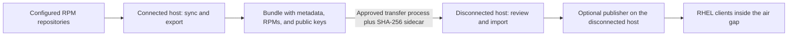
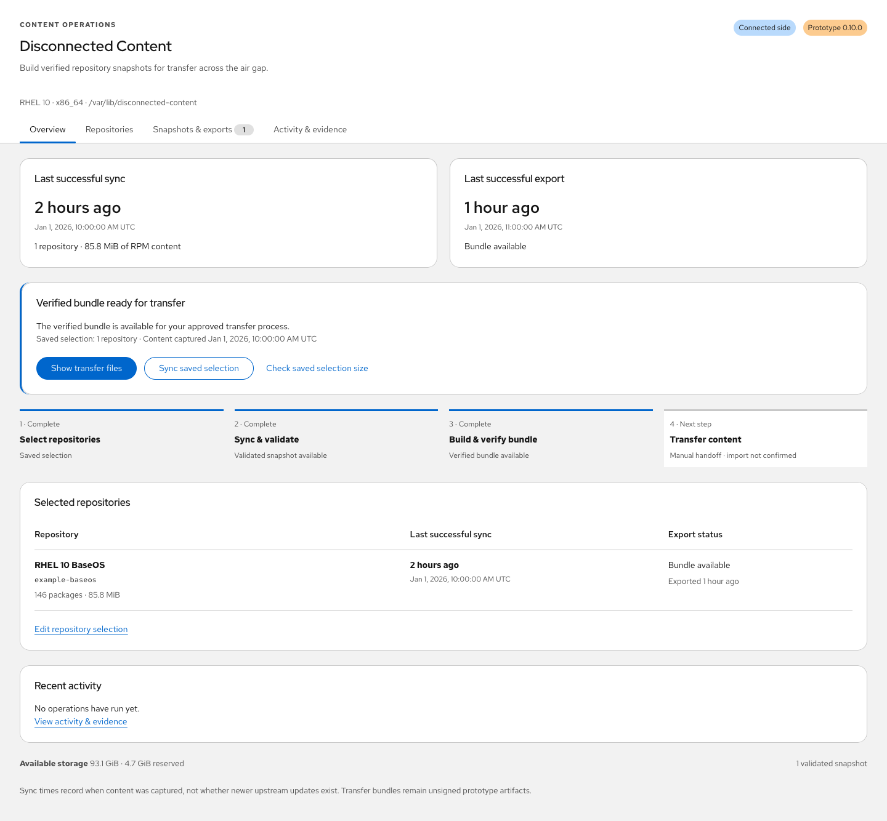
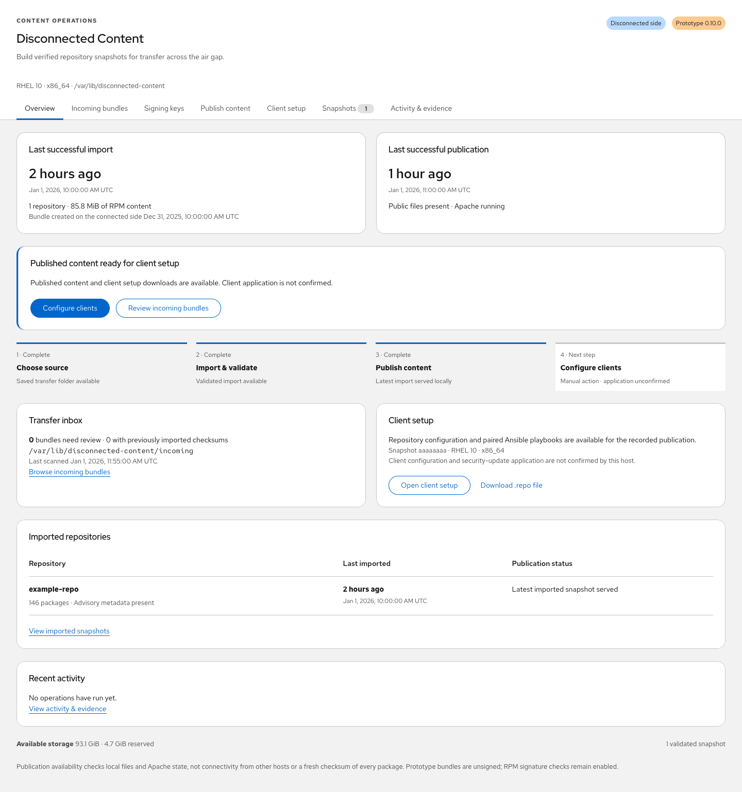
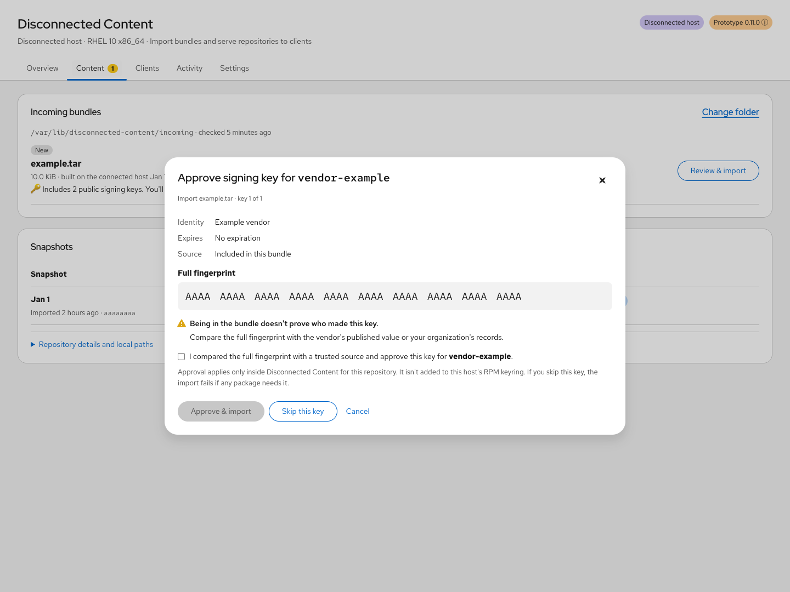
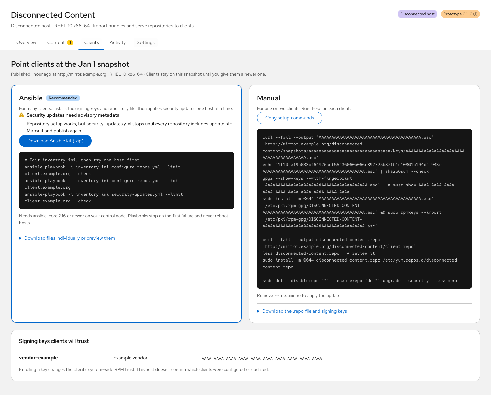

# Disconnected Content for Cockpit

Mirror RPM repositories on a connected RHEL host, carry a verified bundle across
the air gap, and import and publish that content through the RHEL web console.
The disconnected host also generates client repository configuration and Ansible
playbooks for configuring repositories and applying security updates.

**Prototype 0.10.0.** Tested on RHEL 10.2 x86_64. Transfer manifests are currently
unsigned and imports require explicit administrator opt-in. RPM signature checks
remain mandatory. This is an independently maintained prototype; running inside
Cockpit does not create a Red Hat product support commitment. Operators remain
responsible for subscriptions, content access, and their transfer policy.

[Install and select a role](docs/installation.md) ·
[Operator guide](docs/operator-guide.md) ·
[Client automation](docs/automation-options.md) ·
[Build and contribute](docs/development.md) ·
[Validation](docs/validation.md) ·
[Limitations](docs/limitations.md)

## One application, two host roles

**Both modes live in this repository and ship in the same main RPM.** The
root-owned `/etc/disconnected-content/config.json` selects the host's role.
The optional publisher RPM adds Apache configuration and its dependencies.

| Host purpose | Configuration | Packages |
| --- | --- | --- |
| Mirror and export content | `"role": "connected"` | `cockpit-disconnected-content` |
| Import content inside the air gap | `"role": "disconnected"` | `cockpit-disconnected-content` |
| Import and serve repositories to clients | `"role": "disconnected"` | Main RPM plus `cockpit-disconnected-content-publisher` |
| Consume published repositories | Generated `.repo` and approved public keys | No extension installation required |

The backend enforces the configured role. Installing the publisher does not
change the role, start publication, open firewall ports, or configure clients.
Network isolation remains an operating-system and network-policy responsibility.

Today, installation uses DNF and role configuration; there is no role-selecting
installer script. We recommend retaining one application RPM and the optional
publisher, then adding a setup command with an explicit role choice. See the
[current packaging and proposed setup interface](docs/deployment-design.md).

## Get started

1. **Build the RPMs** using the [development guide](docs/development.md), or obtain
   matching artifacts from your approved build process. Prebuilt GitHub releases
   are not currently published.
2. **Install the main RPM on both hosts**, and the optional publisher only where
   repositories will be served. Provision all runtime dependencies before
   isolating the disconnected host, or use an approved offline bootstrap repository.
3. **Choose the role and storage** in the root-owned configuration. A fresh
   installation defaults to connected mode; set the disconnected host explicitly.
   Review the separate unsigned-manifest prototype opt-in before enabling imports.
4. Enable `cockpit.socket`, open your host's web console, and select
   **Disconnected Content** with administrative access.
5. Start with one small repository, complete the workflow below, and configure a
   canary client before expanding the rollout.

[Installation instructions](docs/installation.md) include exact package selection,
connected/disconnected configuration examples, offline prerequisites, upgrades,
and storage planning. Runtime hosts do not need Node.js or npm.

## Connected workflow

Select repositories and a snapshot budget, check capacity, sync and validate the
content, then **Build & verify transfer bundle**. The dashboard shows independent
sync/export ages, per-repository status, the next action, and recent activity.
Long operations run as systemd jobs and continue if the browser closes.

Transfer the `.tar` and its matching `.tar.sha256` together through your approved
process. Exports include original repository metadata, RPMs, and public signing
keys from configured `gpgkey` sources. They exclude subscription certificates,
repository configuration, credentials, and local logs. The connected host does
not claim that a transfer or disconnected import succeeded.

[Connected cycle and export evidence](docs/operator-guide.md#connected-cycle)

## Disconnected workflow

Choose the transfer folder or mounted media in **Incoming bundles**, inspect any
bundled signing keys, approve the required keys, and import the bundle. Then
publish a validated snapshot and open **Client setup**. The dashboard keeps import,
publication, and client-configuration steps visible, with separate timestamps.

The directory picker browses folders on the disconnected host. Only the saved
folder is scanned. A failed import retains diagnostics and does not expose a
partial snapshot. Publishing creates a separately verified public copy; older
snapshot URLs remain available when the current publication advances.

[Transfer inbox and directory picker](docs/operator-guide.md#disconnected-import) ·
[Incoming bundle screenshot](docs/screenshots/incoming-bundles.png)

## Bundled keys require approval

Choose **Review bundled keys** to verify the archive and stage included keys as
untrusted candidates. **Review bundled public key** shows the identity, full
fingerprint, expiration, and source bundle. Verify the fingerprint independently,
confirm it, and explicitly approve the key for its repository before importing.

Including a key in a bundle, inspecting an archive, and viewing a fingerprint do
not grant trust. Existing approvals remain in effect. Imports pin approved keys;
publication revalidates packages with those keys and carries them into client
setup. Unsigned RPMs and invalid signatures are blocked. Bundled keys are not
silently added to the host-wide RPM database.

[Signing-key workflow and trust model](docs/operator-guide.md#repository-signing-keys) ·
[Untrusted candidate screenshot](docs/screenshots/bundled-key-candidates.png)

## Publish and configure clients

The optional Apache publisher serves pinned snapshot repositories and reviewed
public keys. **Client setup** provides a `.repo` file, public-key downloads, setup
commands, and four paired automation downloads:

| Download | Purpose |
| --- | --- |
| `configure-repos.yml` | Verify full key fingerprints, enroll approved keys, install the pinned repository file, and refresh metadata |
| `security-updates.yml` | Check pinned key/configuration files and apply security updates from the selected repositories |
| `inventory.ini` | Example inventory to replace with your approved client hosts |
| `README-client-automation.txt` | Prerequisites, preview/apply commands, and rollout instructions |

Playbooks run from your existing Ansible control node. They process one host at
a time, stop on failure, keep package signature checks enabled, and do not reboot
clients. Reviewed-key setup needs `gnupg2` on clients. Security-only updates need
`updateinfo` in every selected repository; a repository without advisories can
still be configured, but its security playbook stops with an explanation.

Cockpit does not execute fleet jobs, hold client credentials, or mark clients
configured just because files were downloaded. AAP integration remains planned.

[Publication and client setup](docs/operator-guide.md#publish-and-configure-client-hosts) ·
[Ansible prerequisites and rollout](docs/automation-options.md)

## Documentation and project status

All screenshots show the real frontend with **generic demo data**, fixed UTC
timestamps, example repositories, and placeholder fingerprints. They do not show
customer systems or actual keys to trust. See [screenshot regeneration](docs/development.md#reproduce-documentation-screenshots).

- [Installation and role configuration](docs/installation.md)
- [Operator procedures and troubleshooting](docs/operator-guide.md)
- [Packaging decision and proposed setup command](docs/deployment-design.md)
- [Backend architecture and trust boundaries](docs/architecture.md)
- [Validation evidence and tested boundaries](docs/validation.md)
- [Prototype limitations](docs/limitations.md)

Signed manifests, incremental transfers, automated key lifecycle management, and
AAP job execution are future work.

## License

[MIT](LICENSE). Bundled frontend dependencies keep their own licenses; the build
writes their notices to `dist/index.js.LEGAL.txt`.
Keep environment-specific data in ignored local files and use generic examples
in commits, issues, and pull requests.
