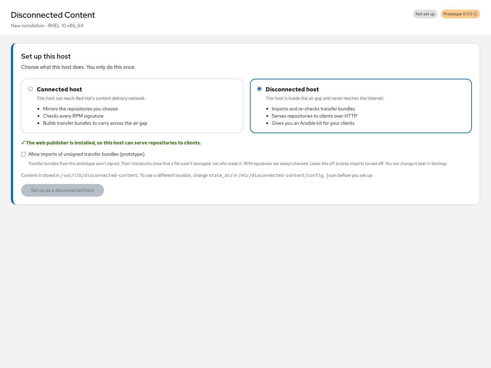

# Installation and role configuration

Packages are built for RHEL 8.10, RHEL 9 (9.3 or later), and RHEL 10. The complete
workflow has been validated on RHEL 10.2 x86_64; RHEL 8 and 9 packages are installed
and started in clean containers on every release. See
[Differences between RHEL releases](#differences-between-rhel-releases). Use the same
RHEL major version and architecture for a connected/disconnected pair and its clients.

## Packages and modes

| Package | Contents | Install on |
| --- | --- | --- |
| `cockpit-disconnected-content` | Both UI modes, Python engine, systemd worker unit, and root-owned configuration | Connected mirror and disconnected import hosts |
| `cockpit-disconnected-content-publisher` | Apache configuration, public content directories, and dependencies on Apache/SELinux tools | Disconnected hosts that will serve repositories |

A fresh installation has no role. The first time you open **Disconnected Content**
in the web console, it asks whether this is a connected or a disconnected host, and
saves the answer in `/etc/disconnected-content/config.json`. The publisher
subpackage doesn't choose a role. It requires the same version and release of the
main package. Backend commands enforce the role; hiding UI tabs is not the
access-control mechanism.



## Download the packages

Each [GitHub release](https://github.com/estuart/cockpit-disconnected-content/releases)
includes the main and publisher RPMs for each RHEL release (`.el8`, `.el9`, and
`.el10`), the source archive, and a `SHA256SUMS` file. Install the packages built for
the host's release. Release RPMs are not GPG-signed yet, so check downloads against
`SHA256SUMS`:

```sh
sha256sum -c SHA256SUMS --ignore-missing
```

A connected host can install the latest release directly. `rpm -E %rhel` prints
the host's major version, so the same command works on RHEL 8, 9, and 10:

```sh
sudo dnf install https://github.com/estuart/cockpit-disconnected-content/releases/latest/download/cockpit-disconnected-content.el$(rpm -E %rhel).noarch.rpm
```

For a disconnected host, download the RPMs and `SHA256SUMS` on a connected machine.
Check them there, then carry them across with your approved transfer process.

To build the packages yourself, follow [the development guide](development.md). The
examples below use version 0.11.0, release 1 for RHEL 10. On RHEL 8 or 9, use the
`.el8` or `.el9` files instead. The two packages must match.

Install the main package explicitly. Avoid a wildcard such as
`cockpit-disconnected-content-*.rpm`: it also matches the publisher and can install
Apache on a host that only needs to mirror content.

## Connected host

Use a registered RHEL host with authorized access to the repositories to mirror.
DNF must already have repository access and the necessary trusted package-signing
keys. The application does not register the system or obtain subscription rights.

```sh
sudo dnf install ./cockpit-disconnected-content-0.11.0-1.el10.noarch.rpm
sudo systemctl enable --now cockpit.socket
```

Open `https://connected.example.org:9090`, sign in with a normal system account
that can obtain administrative access, and select **Disconnected Content**. Choose
**Connected host** and select **Set up as a connected host**.

The extension does not create a separate username or password. Access to the web
console and TCP port 9090 follows your existing certificate and firewall policy.
To set up from a shell instead, for example from automation, run:

```sh
sudo /usr/libexec/disconnected-content setup connected
```

Start with a small configured repository and conservative snapshot budget.

## Disconnected import host

Install the main package and all dependencies before isolation, or from an
approved offline bootstrap repository. The transferred content bundles are not an
installer for Cockpit, this extension, or its runtime dependencies.

For import without HTTP publication:

```sh
sudo dnf install ./cockpit-disconnected-content-0.11.0-1.el10.noarch.rpm
```

For import and HTTP publication:

```sh
sudo dnf install \
  ./cockpit-disconnected-content-0.11.0-1.el10.noarch.rpm \
  ./cockpit-disconnected-content-publisher-0.11.0-1.el10.noarch.rpm
```

Enable the web console with `sudo systemctl enable --now cockpit.socket`, open
`https://disconnected.example.org:9090`, and select **Disconnected Content**.
Choose **Disconnected host**. The setup step shows whether the publisher is
installed and offers one more choice:

- **Allow imports of unsigned transfer bundles (prototype).** This refers to
  **unsigned transfer manifests**, not unsigned RPM packages. Imports stay off
  until you allow it. RPM signatures are always checked; this setting never
  bypasses package signature validation. You can change it later in **Settings →
  Import policy**, or from the **Imports are turned off** card on the overview.

From a shell, `sudo /usr/libexec/disconnected-content setup disconnected` chooses
the role with imports turned off.

Choose the transfer directory in **Settings → Transfer folder → Browse…**; picking
a folder saves it. Mounting media and copying files are separate administrator
operations. **Review & import** asks you to approve any bundled key that isn't
already approved or trusted by this host before the import starts.

### Offline dependencies

The main RPM declares dependencies including Cockpit, Python, DNF plugins, RPM,
GnuPG, zstd, and systemd. The publisher adds Apache and SELinux labeling tools.
Provision the complete dependency closure for the target RHEL release and
architecture. An already installed package on a staging host does not establish
that a fresh offline host has it.

Preferred evaluation path: install dependencies while the future disconnected
host still has approved repository access, then apply isolation. For an already
isolated host, build or use an approved offline bootstrap repository with the
matching dependency RPMs. Do not disable package-signature checks to compensate
for missing bootstrap dependencies or keys. No automated bootstrap-media builder
is included yet.

Runtime hosts do not need Node.js or npm. Ansible is not required on the publisher
for generating downloads; it is required on the separate control node when the
operator runs those downloads.

## Differences between RHEL releases

| | RHEL 8.10 | RHEL 9 | RHEL 10 |
| --- | --- | --- | --- |
| Packages | `.el8` | `.el9` | `.el10` |
| Helper runs on | `python3.12` from AppStream (installed as a dependency) | `python3` 3.9 | `python3` 3.12 |
| Minimum Cockpit | 300, which needs RHEL 8.10 | 300, which needs RHEL 9.3 or later | Included |
| Ansible Core on the control node for clients | 2.16 exactly | 2.16 or later | 2.16 or later |

- On RHEL 8, `python3` is Python 3.6, which the helper doesn't support, so the
  `.el8` package depends on `python3.12`. Include it in the offline dependencies
  for a disconnected RHEL 8 host.
- Ansible Core 2.17 and later can't manage RHEL 8 clients, whose system Python is
  3.6. Playbooks generated for a RHEL 8 publication stop with that explanation
  before contacting clients when run with a newer Ansible Core.
- Each release's RPM verifies signatures with its own OpenPGP implementation, so a
  repository key can be accepted on one release and rejected on another. RPM on
  RHEL 8 can't use EdDSA keys. RHEL 9 and 10 reject SHA-1 signatures under the
  default crypto policy; RHEL 9 may report those packages as having a bad
  signature rather than an untrusted one.
- systemd on RHEL 8 doesn't know two hardening settings in the job unit
  (`Type=exec` and `RestrictSUIDSGID`), so it ignores them and logs a warning. Jobs
  still run as a root service with the other protections.

## Storage and publication

Choose storage before the first job. The state directory must be owned by root
and inaccessible to other users; let the engine create it with mode `0700`, or
precreate it with that ownership and mode. Do not change `state_dir` expecting an
automatic migration of existing snapshots, job history, approvals, or exports.

Allow capacity for:

- Connected snapshots, a complete export archive, and DNF metadata caches.
- Disconnected transfer files, import staging, managed snapshots, and the reserve.
- A separate public repository copy under `/var/www/disconnected-content` when
  publishing. The public copy may be on a different filesystem from private state.

The budget and reserve checks are estimates and guardrails, not quotas. Keep
headroom for concurrent workloads and retained older snapshots.

To publish, install the optional publisher, save the client-facing address when the
overview asks (or in **Settings**), and explicitly publish a validated snapshot. The application
checks Apache configuration, applies web-content SELinux labels, and starts Apache
when publishing. It does not open firewall ports or change network isolation.
Allow inbound HTTP from approved client networks through your existing policy.
The supplied publisher configuration uses HTTP on port 80; HTTPS needs separately
configured certificates and a TLS listener. Entering an HTTPS URL does not set up TLS.

## Upgrades and changing roles

Upgrade the main package on both kinds of host. On a publisher, upgrade both
packages together to matching version/release. The root configuration uses RPM
`%config(noreplace)` handling; review any `.rpmnew` file and preserve custom settings.
Package upgrades do not migrate content directories or adopt newly published
content on client hosts.

Versions up to 0.11.0 shipped a configuration with `"role": "connected"`. If a host
never changed that file, RPM replaces it with the new role-less default during the
upgrade. The next time you open the extension, the setup step appears with the
role it detects from existing content already selected. Snapshots, exports, and
approvals stay where they are. Confirm the role to continue.

The role is chosen once. The setup step refuses to switch an already configured
host to the other role, and every change it makes first saves a timestamped copy
of the previous file as `config.json.bak-*` in the same directory. Role changes
are manual in this version. Stop or finish active work first and plan the change
around existing state. Changing a string does not move content,
undo a publication, enable subscriptions, or create a network air gap. The
recommended deployment uses separate hosts with roles selected before first use.

See [the packaging decision](deployment-design.md) for how setup works and the
safeguards it applies. See [operator procedures](operator-guide.md) for the
complete sync, key review, import, publication, and client workflow.
