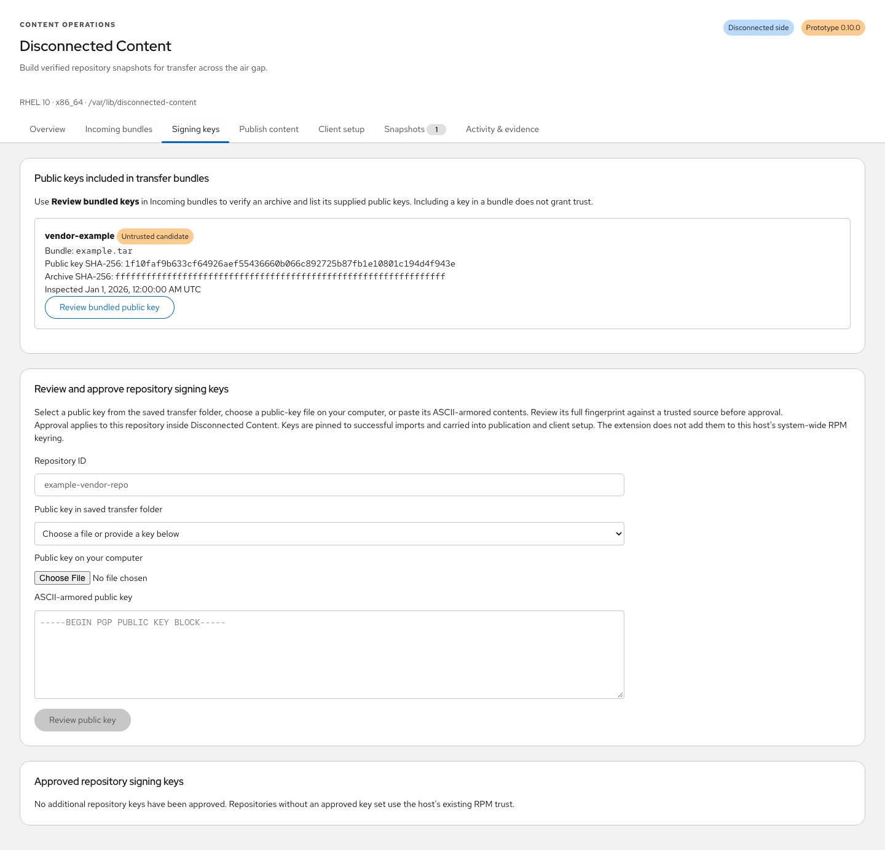

# Operator guide

Use this guide after completing [installation and role configuration](installation.md).
The screenshots in the README use generic demo data. Actual repository names,
package counts, signing keys, timestamps, and storage values come from your hosts.

## Connected cycle

The connected **Overview** is an operations dashboard. It shows the last
successful sync and export with relative ages and exact local timestamps, a
recommended next action, the saved selection's workflow, per-repository sync and
export status, a matching size check, recent activity, and available storage.

1. Select repositories in **Repositories**, set a budget, and save the profile.
2. Run **Check saved selection size** and inspect the timestamped result.
3. Run **Sync saved selection**. The workflow shows the operation's stage and
   elapsed time; jobs continue in a system service if the browser is closed.
4. Use **Build & verify transfer bundle** when the saved selection has a validated
   snapshot. A new sync never inherits an older snapshot's export status.
5. Open **Snapshots & exports** or **Show transfer files** for archive and checksum
   paths, creation and verification times, file availability, and detailed evidence.
6. Carry the `.tar` and matching `.tar.sha256` through the approved transfer process.
   The connected host does not claim that transfer or disconnected import succeeded.

Dashboard actions use the saved selection. Unsaved edits remain in the repository
form until saved. Sync times describe when content was captured, not whether newer
upstream packages exist. Size results are scoped to the saved selection and budget;
each sync checks capacity again. **Activity & evidence** retains detailed job logs.

Export records persist independently of the recent 50 jobs returned to the UI.
Older successful export jobs are migrated without changing their export dates;
legacy bundles require an explicit verification before being shown ready. The
dashboard checks archive attributes and the checksum sidecar without hashing
large archives every poll. Missing or changed files require verification or a
rebuild. Explicit verification checks archive contents, snapshot identity, and
the archive digest against its sidecar; it updates verification time while
preserving the original export time.

The source host's enabled repositories are preserved. Each command enables only
the profile's repositories for that invocation. The application does not export
subscription certificates, repository configuration, or local job logs.

Bundles are **unsigned** in this version. Their hashes detect content corruption;
they do not establish who produced the bundle. RPM signatures remain independently
verified against approved repository keys, or the host's existing RPM keyring
when no repository-specific keys are configured. Do not treat a transferred key
and an accompanying bundle as an independent trust anchor.

## Repository signing keys

Exports now include public keys from each mirrored repository's configured
`gpgkey` sources (`file://` or HTTPS). Files with multiple public certificates
are split into individual bounded certificates. Only public certificate packets
are accepted; private keys, credentials, repository configuration, and source URLs
are excluded from the collected key payload. Export fails clearly if a configured
key source cannot be collected. Repositories with no configured key source include
no key; existing host trust or separately supplied public keys remain available.

On the disconnected side, choose **Incoming bundles → Review bundled keys**.


The app verifies the archive sidecar and every declared file checksum, then stages
the included keys as **Untrusted candidates**. Select **Review bundled public key**
to see the full fingerprint and confirm approval. Inspecting the archive and
viewing a key never enroll it. Previously approved keys remain approved; bundled
copies do not overwrite existing trust. The manifest includes repository-to-key
paths and SHA-256 values, with no trust or approval assertion. Older bundles
without key entries remain supported. Rebuild an export to include the new keys;
existing transfer files do not gain keys retroactively.



For third-party or internal content with a separately supplied public key, use
**Signing keys** on the disconnected host:

1. Place one ASCII-armored public key (`.asc`, `.key`, or `.pub`, at most 64 KiB)
   in the saved transfer folder and scan again, or select a file on your computer
   or paste its contents. Keys are never fetched from the internet by the importer.
2. Specify the exact repository ID from the incoming bundle or failed import.
   Choose **Review public key** to see its identity, full fingerprint, expiration,
   and key-file SHA-256. Review does not grant trust.
3. Verify the full fingerprint against an approved vendor source or trusted record.
   Confirm the checkbox and choose **Approve signing key** within 15 minutes.
   Changing the repository or supplied key invalidates the displayed review.
4. Return to **Incoming bundles** and retry the import. A missing key is reported
   separately from unsigned RPMs, invalid signatures, and other verification errors.
   RPM diagnostics are retained in **Activity & evidence**.

Approval is an administrative action scoped to the repository inside the extension.
Validation uses an isolated RPM database containing only that repository's approved
keys; it does not enroll them in this host's system-wide RPM keyring. Without an
approved key set, existing RPM trust is used. Private, expired, revoked, malformed,
and multiple-primary-key uploads are rejected. No signature bypass is provided.

Successful imports pin the approved public key bytes, full fingerprints, SHA-256,
and approval timestamps in snapshot evidence. Publication rechecks RPM signatures
with the pinned keys and serves the exact public key files under
`/disconnected-content/snapshots/<snapshot-id>/keys/<fingerprint>.asc`.
The generated `.repo` references dedicated local files in `/etc/pki/rpm-gpg/`.
**Client setup** provides public-key downloads, published URLs, fingerprints,
checksums, and manual setup commands. Review the fingerprints and checksum results
before enrolling keys; do not treat the download server as an independent trust anchor.

The paired `configure-repos.yml` embeds those exact public keys and enrolls them
after explicit full fingerprint checks before refreshing DNF.
This changes the client's system-wide RPM trust and must be reviewed with the playbook.
Clients need `gnupg2` for full fingerprint verification; provision it from approved
installation media before running the playbook.
Check mode previews files and skips enrollment and metadata refresh. The security
playbook checks the pinned public-key files and repository configuration before
updating. `gpgcheck=1` and `disable_gpg_check=false` remain enabled. Repositories
without reviewed keys retain the independently provisioned Red Hat key file.

## Disconnected import

The disconnected **Overview** follows **Choose source → Import & validate →
Publish content → Configure clients**. It shows independent import/publication
ages, the next action, pending inbox files, imported repository status, local
publication availability, and recent activity. Client setup remains a manual
step and is never marked complete because files were downloaded.

**Publish content** holds web-server settings and the explicit snapshot
publication action. **Client setup** contains the recorded publication's `.repo`
file, setup commands, paired Ansible playbooks, inventory, and instructions.
Changing the saved server URL requires reviewing and republishing; draft edits
are not saved by dashboard navigation. Unmounted transfer media does not block
using content that is already imported and published.

Install the application and its runtime dependencies before isolating the host,
or provide them through an approved offline bootstrap repository. The importer
does not download packages or require access to the sync host.

Configure the root-owned `/etc/disconnected-content/config.json` for this role:

```json
{
  "role": "disconnected",
  "state_dir": "/var/lib/disconnected-content",
  "reserve_gib": 5,
  "max_import_gib": 200,
  "allow_unsigned_imports": false
}
```

This version produces unsigned bundles. Import is rejected by default. For an
explicitly approved prototype test, set `allow_unsigned_imports` to `true` as an
administrator. This does not authenticate the manifest; RPM signatures are still
required and validated against approved repository keys or the existing host keyring.

1. Open **Incoming bundles**, choose **Browse folders**, and navigate to the
   transfer folder on the disconnected host. Mounted drives appear under
   **Mounted filesystems**; **Quick locations** includes the saved source,
   filesystem root, and existing common mount directories. Use breadcrumbs,
   **Up one folder**, and the folder filter to navigate, then choose
   **Use this folder**. You can also enter an absolute path directly.
2. Choose **Save & scan** to persist the source. Stage the `.tar` and matching
   `.tar.sha256` there using the approved transfer process, then **Scan now**.
   The source must be a real directory without symlink components. Only that
   directory is scanned; subdirectories are not searched. Browsing and choosing
   a folder do not change the saved source until **Save & scan** is selected.
   Mounting media and transferring files are currently administrator tasks
   outside the application.
3. Choose **Import bundle**. The application never imports automatically.
4. Follow the job under **Activity & evidence**. A failed import leaves no usable
   snapshot and removes its private extraction staging directory.
5. Open **Snapshots** for validation results and local `file://` repository URLs.

The importer checks the outer checksum, manifest schema, size/file-count limits,
safe paths, file checksums, RHEL major version, architecture, repository metadata,
and trusted RPM signatures. Archive ownership, modes, links, special files, sparse
files, duplicate members, and unexpected paths are not accepted or applied.
An identical bundle can be imported again without duplicating or replacing its
snapshot. Publishing and client rollout are explicit subsequent steps.

The source directory is separate from managed snapshot storage. The GUI saves
only `incoming_dir` and its settings timestamp in the root-owned configuration;
it cannot change the role, state directory, size limits, or unsigned-import policy.
Saving does not create, move, delete, or change permissions on source files.
It requires administrative access and is blocked while a job is active. Each
import records its selected source directory in the job. Missing media is shown
as unavailable without hiding existing snapshots or job history.

Incoming bundles are sorted by filesystem modification time, newest first.
Copying may preserve this time, so it is not an arrival timestamp. Jobs show
queued, started, last-updated, and finished times where recorded, plus duration.
Successful archive checks record a verification timestamp; identical reimports
record when the archive matched the existing snapshot. Imported snapshots also
show their import time and source bundle creation time. Dates include the
browser's local timezone; hovering a timestamp reveals its original ISO value.
Older records retain the evidence they actually captured without invented dates.

## Publish and configure client hosts

Install the optional `cockpit-disconnected-content-publisher` RPM and its Apache
dependencies on the disconnected host before isolation or from an offline
bootstrap repository. Connected sync hosts do not need this subpackage.

1. Open **Publish content**, enter the server URL clients can reach, such as
   `http://mirror.example.org`, and select **Save server URL**.
2. Select an imported, validated snapshot and choose **Publish snapshot**. This
   creates a separate copy of indexed repository metadata and RPMs under
   `/var/www/disconnected-content/public/snapshots/<snapshot-id>/`, verifies it,
   applies SELinux labels, checks Apache configuration, and starts the server.
3. Permit inbound TCP port 80 from approved client networks through your firewall
   policy. Publication does not modify firewall rules or network isolation.
4. Download the displayed `.repo` file and install it on compatible client hosts
   as `/etc/yum.repos.d/disconnected-content.repo`. Review the displayed setup
   commands to refresh metadata, inspect security advisories, and preview updates.

The GUI shows the current publication and timestamp, complete configuration, and
client commands. Package GPG checks stay enabled, with keys provisioned and
reviewed before enrollment on clients. The configuration playbook enrolls approved
repository keys with full fingerprint checks. Original repository metadata is not signed by
this prototype (`repo_gpgcheck=0`). The default Apache setup provides HTTP; HTTPS
and certificate trust require separately configured TLS. Entering an HTTPS URL
does not configure the server's TLS listener.

Every generated repository URL pins a specific published snapshot. Publishing
new content updates `/disconnected-content/client.repo`, while older snapshot
URLs remain usable. Existing clients advance only when an administrator installs
the newer configuration. This avoids changing repository content during an
in-progress package transaction. Switching repositories does not undo installed
updates. HTTP content is readable by hosts allowed through the network policy;
web-client authentication is not included in the initial publisher.

Publication copies repository content rather than exposing private engine state.
It requires additional storage for the public copy; the reserve is checked on
the publication filesystem. Logs, jobs, inbox archives, snapshot state files, and
unindexed files are excluded. Private staging is outside the Apache alias.

The **Client setup** tab provides repository configuration, two downloadable playbooks,
an example inventory, and run instructions. Configure a canary client's pinned
repositories, preview security updates with `--check --diff`, then apply during
a maintenance window. The update playbook requires the exact paired repository
file and advisory metadata, selects only its publication's repository IDs, runs
one host at a time, and stops on failure. Neither playbook reboots clients.

Run the downloads from your existing Ansible Core 2.16+ control node. Cockpit does
not store client credentials or execute Ansible. See [client automation](automation-options.md)
for prerequisites, commands, and the later AAP integration direction.


## Troubleshooting

| Symptom | Check and next action |
| --- | --- |
| Connected tabs on an import host | Check the root-owned configuration's `role`; installing the publisher does not change it |
| Unsigned prototype imports disabled | Review the prototype manifest policy and the explicit administrator opt-in in the installation guide; RPM signatures remain required |
| Transfer archive missing | Mount the media, choose the correct folder, save it, and scan again; only the selected folder is scanned |
| Checksum sidecar missing or mismatched | Transfer the matching `.tar.sha256` with the archive; replace a changed/corrupt transfer from a verified export |
| No keys included in an old bundle | Rebuild the connected export or supply an approved public key separately |
| Missing RPM signing key | Review the bundled key, verify its full fingerprint independently, approve it, and retry import |
| Invalid RPM signature or package checksum | Replace the affected content from a verified source; no signature bypass is available |
| Publication unavailable | Check the optional publisher package, Apache state, public-file checks, client-facing URL, and firewall policy |
| Security-update playbook stops for missing advisories | Mirror `updateinfo` for every selected repository; repository configuration can still be used without a security-only update transaction |
| Client playbook reports a missing or changed key/configuration | Download the matching pair from the intended publication and run its configuration playbook before previewing updates |

Use **Activity & evidence** to inspect the affected job's timestamps, stage, and
retained diagnostic output. A successful download does not establish that clients
were configured or patched. Identical reimports can match an existing snapshot
without repeating full RPM validation; use a fresh, unimported bundle for an
end-to-end first-import test. Historical snapshots retain their pinned key
evidence, so removing a current approval is not a revocation of past content.
