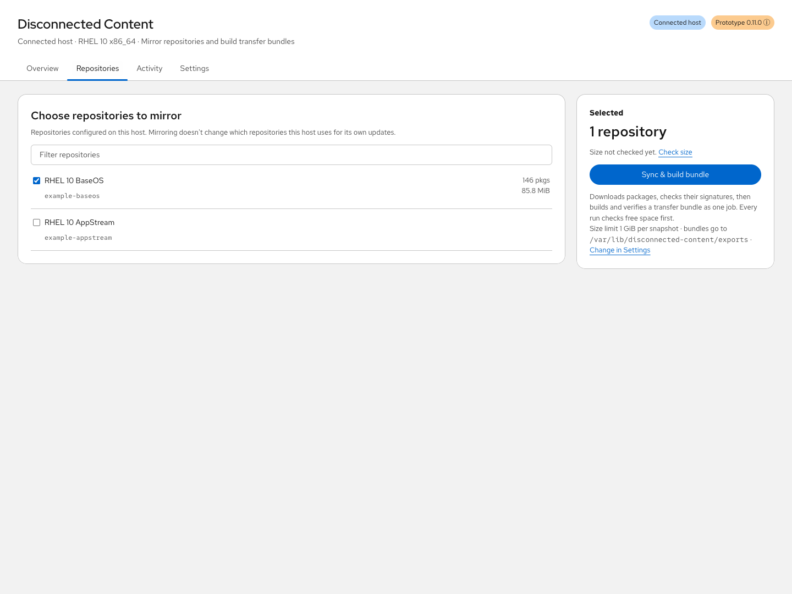
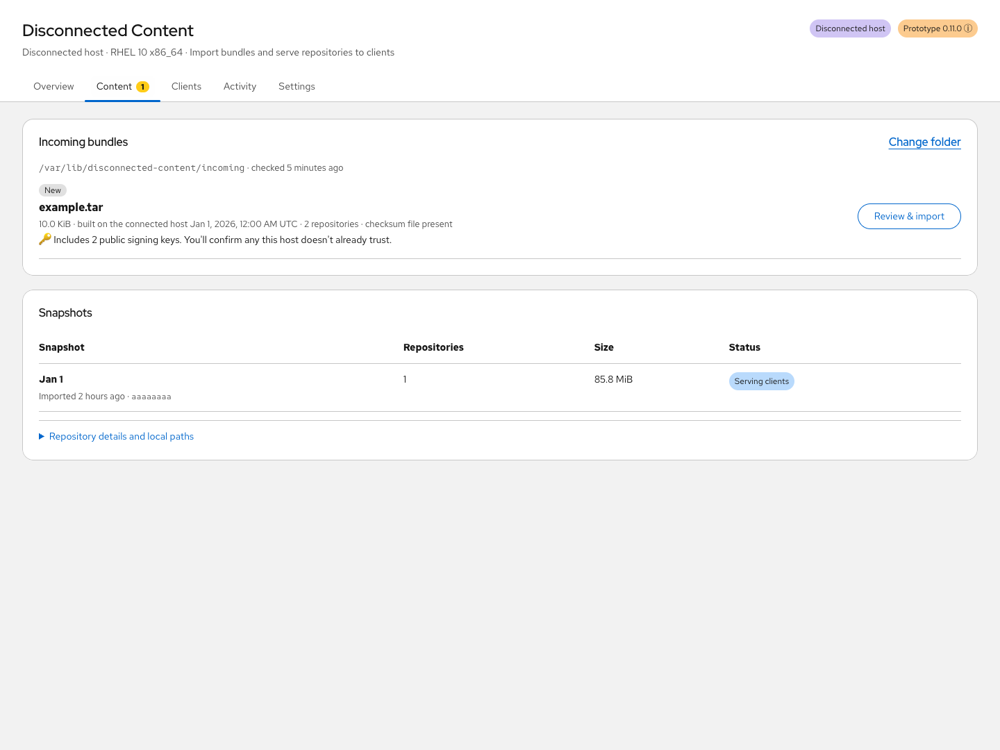

# Operator guide

Use this guide after completing [installation and role configuration](installation.md).
The screenshots in the README use generic demo data. Actual repository names,
package counts, signing keys, timestamps, and storage values come from your hosts.

## Connected cycle

The connected **Overview** shows one next action, a three-step progress bar
(**Choose repositories → Sync & build bundle → Transfer both files**), the selected
repositories with package counts and sync ages, and available storage.


1. Select repositories in **Repositories**. Each change saves immediately. The
   summary panel shows the last size check for the saved selection; choose
   **Check size** for a fresh estimate.
2. Choose **Sync & build bundle**. One job checks free space, downloads packages
   and original metadata, validates metadata and RPM signatures, then builds and
   verifies the transfer bundle. Progress shows the current step; the job
   continues in a system service if the browser is closed.
3. When the bundle is ready, the overview shows the `.tar` and `.tar.sha256`
   paths with **Copy path** buttons. Carry both files through the approved
   transfer process. The connected host does not claim that transfer or
   disconnected import succeeded.

**Settings** holds the export folder (where new bundles and checksum files are
written, such as a mounted transfer drive) and the per-snapshot size limit. The
folder must be a real directory without symlinks, outside private state, and
writable by root; choosing one with **Browse…** saves it. Existing bundles stay
where they were written, and their records keep that path. If the folder becomes
unavailable, exports stop with a clear message until it is mounted again.

Mirrors always contain the complete repository. Package filters in the host's own
repository files (`includepkgs`, `excludepkgs`) are ignored during size checks and
downloads (`--disableexcludes=all`); they continue to apply to the host's updates.
Repositories that contain unsigned packages cannot be mirrored, and the failure
names an example package. HTTPS certificates are always verified; for a private
certificate authority, add the CA to the system trust store with `update-ca-trust`.

If the bundle step fails after a successful sync, the retry rebuilds only the
bundle. The **⋮** menu next to a ready bundle can verify it again, rebuild it, or
check repository sizes. **Older snapshots** at the bottom of the overview lists
earlier content with its bundle state. Sync times describe when content was
captured, not whether newer upstream packages exist. **Activity** retains each
job's timestamps, results, and command output.



Export records persist independently of the recent 50 jobs returned to the UI.
Older successful export jobs are migrated without changing their export dates;
legacy bundles require an explicit verification before being shown ready. The
dashboard checks archive attributes and the checksum sidecar without hashing
large archives every poll. Missing or changed files require verification or a
rebuild. Explicit verification checks archive contents, snapshot identity, and
the archive digest against its sidecar; it updates verification time while
preserving the original export time.

The source host's enabled repositories are preserved. Each command enables only
the profile's repositories for that invocation. The application does not export
subscription certificates, repository configuration, or local job logs.

Bundles are **unsigned** in this version. Their hashes detect content corruption;
they do not establish who produced the bundle. RPM signatures remain independently
verified against approved repository keys, or the host's existing RPM keyring
when no repository-specific keys are configured. Do not treat a transferred key
and an accompanying bundle as an independent trust anchor.

## Repository signing keys

Exports now include public keys from each mirrored repository's configured
`gpgkey` sources (`file://` or HTTPS). Files with multiple public certificates
are split into individual bounded certificates. Only public certificate packets
are accepted; private keys, credentials, repository configuration, and source URLs
are excluded from the collected key payload. Export fails clearly if a configured
key source cannot be collected. Repositories with no configured key source include
no key; existing host trust or separately supplied public keys remain available.

On the disconnected side, bundles that include keys say so before import. Choose
**Review & import**:



1. The app verifies the archive sidecar and every declared file checksum, then
   stages the included keys as untrusted candidates. Inspecting the archive never
   enrolls a key.
2. Keys already approved for that repository, and keys whose full fingerprint is
   already in this host's RPM keyring, are not shown again. The host-keyring check
   only decides whether to ask; it does not grant trust.
3. For each remaining key, the dialog shows its identity, expiration, and full
   fingerprint. Verify the fingerprint against an approved vendor source or
   trusted record, confirm the checkbox, and choose **Approve & import** (or
   **Approve & continue** when more keys follow). The review expires after 15
   minutes. **Skip this key** leaves it unapproved; the import fails if any
   package needs it. **Cancel** approves nothing and starts nothing.
4. The import starts after the last decision. A bundle without keys imports in
   one click.


Previously approved keys remain approved; bundled copies do not overwrite existing
trust. The manifest includes repository-to-key paths and SHA-256 values, with no
trust or approval assertion. Older bundles without key entries remain supported.
Rebuild an export to include keys; existing transfer files do not gain keys
retroactively.

For third-party or internal content with a separately supplied public key, use
**Settings → Approved signing keys → Add a key manually**:

1. Enter the exact repository ID. Choose a public-key file in the transfer folder
   (`.asc`, `.key`, or `.pub`, at most 64 KiB), select one on your computer, or
   paste its contents. Keys are never fetched from the internet by the importer.
2. Choose **Review key** to see its identity, full fingerprint, and expiration.
   Review does not grant trust. Changing the repository or key clears the review.
3. Verify the full fingerprint, confirm the checkbox, and choose **Approve key**.
4. Import the bundle again. A missing key is reported separately from unsigned
   RPMs, invalid signatures, and other verification errors. RPM diagnostics are
   retained in **Activity**.

Approval is an administrative action scoped to the repository inside the extension.
Validation uses an isolated RPM database containing only that repository's approved
keys; it does not enroll them in this host's system-wide RPM keyring. Without an
approved key set, existing RPM trust is used. Private, expired, revoked, malformed,
and multiple-primary-key uploads are rejected. No signature bypass is provided.

Successful imports pin the approved public key bytes, full fingerprints, SHA-256,
and approval timestamps in snapshot evidence. Publication rechecks RPM signatures
with the pinned keys and serves the exact public key files under
`/disconnected-content/snapshots/<snapshot-id>/keys/<fingerprint>.asc`.
The generated `.repo` references dedicated local files in `/etc/pki/rpm-gpg/`.
**Clients** lists the keys clients will trust and provides manual setup commands
that check each key's SHA-256 and fingerprint, plus key downloads. Review the fingerprints and checksum results
before enrolling keys; do not treat the download server as an independent trust anchor.

The paired `configure-repos.yml` embeds those exact public keys and enrolls them
after explicit full fingerprint checks before refreshing DNF.
This changes the client's system-wide RPM trust and must be reviewed with the playbook.
Clients need `gnupg2` for full fingerprint verification; provision it from approved
installation media before running the playbook.
Check mode previews files and skips enrollment and metadata refresh. The security
playbook checks the pinned public-key files and repository configuration before
updating. `gpgcheck=1` and `disable_gpg_check=false` remain enabled. Repositories
without reviewed keys retain the independently provisioned Red Hat key file.

## Disconnected import

The disconnected **Overview** follows **Import → Publish → Configure clients**.
It shows one next action, what clients are currently served, and the transfer
folder's status. **Content** lists incoming bundles and imported snapshots,
**Clients** holds setup downloads for the current publication, and **Settings**
holds the transfer folder, client-facing address, publisher status, approved keys,
and the import policy. Client setup is never marked complete because files were
downloaded. Unmounted transfer media does not block using content that is
already imported and published.


Install the application and its runtime dependencies before isolating the host,
or provide them through an approved offline bootstrap repository. The importer
does not download packages or require access to the sync host.

Configure the root-owned `/etc/disconnected-content/config.json` for this role:

```json
{
  "role": "disconnected",
  "state_dir": "/var/lib/disconnected-content",
  "reserve_gib": 5,
  "max_import_gib": 200,
  "allow_unsigned_imports": false
}
```

This version produces unsigned bundles. Import is rejected by default. For an
explicitly approved prototype test, set `allow_unsigned_imports` to `true` as an
administrator. This does not authenticate the manifest; RPM signatures are still
required and validated against approved repository keys or the existing host keyring.

1. Open **Settings → Transfer folder → Browse…** and navigate to the transfer
   folder on the disconnected host. Mounted drives appear under **Mounted
   filesystems**; **Quick locations** includes the saved source, filesystem
   root, and existing common mount directories. Choose **Use this folder** to
   save it. You can also type an absolute path and choose **Save**.
2. Stage the `.tar` and matching `.tar.sha256` there using the approved transfer
   process. The page checks the folder automatically. The source must be a real
   directory without symlink components, and only that directory is scanned.
   Mounting media and transferring files are administrator tasks outside the
   application.
3. Choose **Import** or **Review & import** on the overview or **Content**. The
   application never imports automatically. The overview shows progress.
4. A failed import leaves no usable snapshot and removes its private extraction
   staging directory. **Activity** retains the stage and diagnostics.
5. **Content → Snapshots** lists validation results; expand **Repository details
   and local paths** for local `file://` repository URLs.

The bundle card's repository count, build time, and key count come from the
unverified manifest and are for display only. Every import verifies the archive
and its contents again.

The importer checks the outer checksum, manifest schema, size/file-count limits,
safe paths, file checksums, RHEL major version, architecture, repository metadata,
and trusted RPM signatures. Archive ownership, modes, links, special files, sparse
files, duplicate members, and unexpected paths are not accepted or applied.
An identical bundle can be imported again without duplicating or replacing its
snapshot. Publishing and client rollout are explicit subsequent steps.

The source directory is separate from managed snapshot storage. The GUI saves
only `incoming_dir` and its settings timestamp in the root-owned configuration;
it cannot change the role, state directory, size limits, or unsigned-import policy.
Saving does not create, move, delete, or change permissions on source files.
It requires administrative access and is blocked while a job is active. Each
import records its selected source directory in the job. Missing media is shown
as unavailable without hiding existing snapshots or job history.

Incoming bundles are sorted by filesystem modification time, newest first.
Copying may preserve this time, so it is not an arrival timestamp. Jobs show
queued, started, last-updated, and finished times where recorded, plus duration.
Successful archive checks record a verification timestamp; identical reimports
record when the archive matched the existing snapshot. Imported snapshots also
show their import time and source bundle creation time. Dates include the
browser's local timezone; hovering a timestamp reveals its original ISO value.
Older records retain the evidence they actually captured without invented dates.

## Publish and configure client hosts

Install the optional `cockpit-disconnected-content-publisher` RPM and its Apache
dependencies on the disconnected host before isolation or from an offline
bootstrap repository. Connected sync hosts do not need this subpackage.

1. Enter the address clients can reach, such as `http://mirror.example.org`,
   when the overview asks for it, or under **Settings → Client-facing address**.
2. After an import, the overview offers **Publish ‹date› snapshot** for the
   latest import. This creates a separate copy of indexed repository metadata and
   RPMs under `/var/www/disconnected-content/public/snapshots/<snapshot-id>/`,
   verifies it, applies SELinux labels, checks Apache configuration, and starts
   the server. To publish an older snapshot, use **Content → Snapshots → Publish**.
3. Permit inbound TCP port 80 from approved client networks through your firewall
   policy. Publication does not modify firewall rules or network isolation.
4. Open **Clients** and choose the Ansible kit or the manual commands.

The GUI shows the current publication and timestamp, complete configuration, and
client commands. Package GPG checks stay enabled, with keys provisioned and
reviewed before enrollment on clients. The configuration playbook enrolls approved
repository keys with full fingerprint checks. Original repository metadata is not signed by
this prototype (`repo_gpgcheck=0`). The default Apache setup provides HTTP; HTTPS
and certificate trust require separately configured TLS. Entering an HTTPS URL
does not configure the server's TLS listener.

Every generated repository URL pins a specific published snapshot. Publishing
new content updates `/disconnected-content/client.repo`, while older snapshot
URLs remain usable. Existing clients advance only when an administrator installs
the newer configuration. This avoids changing repository content during an
in-progress package transaction. Switching repositories does not undo installed
updates. HTTP content is readable by hosts allowed through the network policy;
web-client authentication is not included in the initial publisher.

Publication copies repository content rather than exposing private engine state.
It requires additional storage for the public copy; the reserve is checked on
the publication filesystem. Logs, jobs, inbox archives, snapshot state files, and
unindexed files are excluded. Private staging is outside the Apache alias.

**Clients → Ansible → Download Ansible kit (.zip)** provides two playbooks, an
example inventory, and run instructions in one archive. Configure a canary client's pinned
repositories, preview security updates with `--check --diff`, then apply during
a maintenance window. The update playbook requires the exact paired repository
file and advisory metadata, selects only its publication's repository IDs, runs
one host at a time, and stops on failure. Neither playbook reboots clients.

Run the downloads from your existing Ansible Core 2.16+ control node. Cockpit does
not store client credentials or execute Ansible. See [client automation](automation-options.md)
for prerequisites, commands, and the later AAP integration direction.


## Troubleshooting

| Symptom | Check and next action |
| --- | --- |
| Connected tabs on an import host | Check the root-owned configuration's `role`; installing the publisher does not change it |
| Unsigned prototype imports disabled | Review the prototype manifest policy and the explicit administrator opt-in in the installation guide; RPM signatures remain required |
| Sync reports unsigned packages | The repository includes unsigned RPMs; choose a repository whose packages are all signed |
| Export folder unavailable | Mount the drive at the saved path or choose another folder in Settings |
| Transfer archive missing | Mount the media and choose the correct folder in Settings; only the selected folder is scanned |
| Checksum sidecar missing or mismatched | Transfer the matching `.tar.sha256` with the archive; replace a changed/corrupt transfer from a verified export |
| No keys included in an old bundle | Rebuild the connected export or supply an approved public key separately |
| Missing RPM signing key | Choose Review & import again and approve the key, or add it under Settings → Add a key manually |
| Invalid RPM signature or package checksum | Replace the affected content from a verified source; no signature bypass is available |
| Publication unavailable | Check the optional publisher package, Apache state, public-file checks, client-facing URL, and firewall policy |
| Security-update playbook stops for missing advisories | Mirror `updateinfo` for every selected repository; repository configuration can still be used without a security-only update transaction |
| Client playbook reports a missing or changed key/configuration | Download the matching pair from the intended publication and run its configuration playbook before previewing updates |

Use **Activity** to inspect the affected job's timestamps, stage, and
retained diagnostic output. A successful download does not establish that clients
were configured or patched. Identical reimports can match an existing snapshot
without repeating full RPM validation; use a fresh, unimported bundle for an
end-to-end first-import test. Historical snapshots retain their pinned key
evidence, so removing a current approval is not a revocation of past content.
